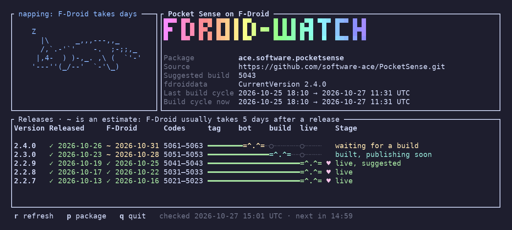
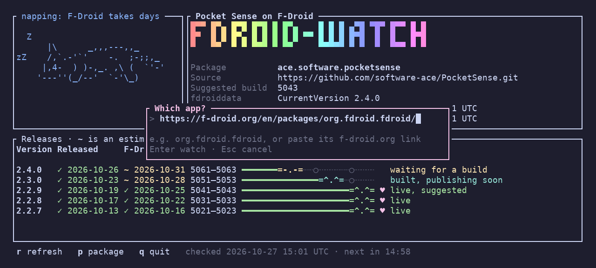

# fdroid-watch

[](https://github.com/sponsors/software-ace)
[](https://crates.io/crates/fdroid-watch)

A terminal dashboard showing where each release of an F-Droid app is on its way to f-droid.org:
tagged in its source repo → picked up in fdroiddata by the update bot → built in a build cycle → live on f-droid.org.

Works for any app in the main F-Droid repo whose source is on GitHub, GitLab, Codeberg or another Gitea/Forgejo host.



Switching to another app with `p`; an f-droid.org link works as well as a package id:



## Install

Needs Rust ([rustup](https://rustup.rs)).

```sh
cargo install fdroid-watch
```

Cargo puts `fdroid-watch` in `~/.cargo/bin`, or in `$CARGO_INSTALL_ROOT/bin` if that's set. That directory has to be on your `PATH` (fish: `fish_add_path ~/.cargo/bin`). Run the same command again to update; `cargo uninstall fdroid-watch` removes it.

The latest unreleased code: `cargo install --git https://github.com/software-ace/fdroid-watch`. From a clone, `cargo install --path .`.

## Use

```sh
fdroid-watch                      # asks which app
fdroid-watch org.fdroid.fdroid
```

The package id is the one in the app's f-droid.org URL (`f-droid.org/packages/<package-id>/`); pasting the whole link works too. It fetches on start and every 15 minutes in the background; `r` refreshes now, `p` switches to another app, `q` quits.

Each version has a cat walking its tag → bot → build → live track, with the date it was released in the source repo and the date f-droid.org added it, or an estimate (`~`): the release date plus the median delay of past releases. The big cat shows the mood: hunting while fetching, napping while F-Droid takes its days, purring once the newest release is live, hissing if a build failed.

Stages: *skipped* is a tag the bot never picked up (it only takes the newest it sees); *archived* is an older version f-droid.org has moved to its archive repo.

Sources, all public, no tokens:

- `metadata/<package-id>.yml` in fdroiddata, for the builds, the app's name and its source repo
- the tags and releases of that repo (GitHub, GitLab or Gitea/Forgejo API)
- `f-droid.org/api/v1/packages/<package-id>`
- the package page on f-droid.org, for the "Added on" dates the API leaves out
- `f-droid.org/repo/status/build.json` (last build cycle) and `running.json` (current one)

Tags are matched to F-Droid's `versionName` after dropping any prefix before the first digit (`v1.2.3` → `1.2.3`). An app whose tags don't contain its version name will show its tags and its F-Droid builds as separate rows.

GitHub allows 60 unauthenticated API calls an hour per IP; fdroid-watch makes 2 per refresh.

## Develop

`cargo test` checks the parsing; `cargo test -- --ignored --nocapture` draws one live fetch as text, for the app in `FDROID_WATCH_PKG` (default `ace.software.pocketsense`).

## Releasing

Bump `version` in `Cargo.toml`, commit, push, then tag and push the tag:

```sh
git tag v0.2.0 && git push origin v0.2.0
```

The Release workflow checks the tag matches `Cargo.toml`, runs the tests, publishes to crates.io (trusted publishing, no stored token) and makes the GitHub release with notes from the commits since the last tag.

## License

GPL-3.0-or-later. See [LICENSE](LICENSE).
